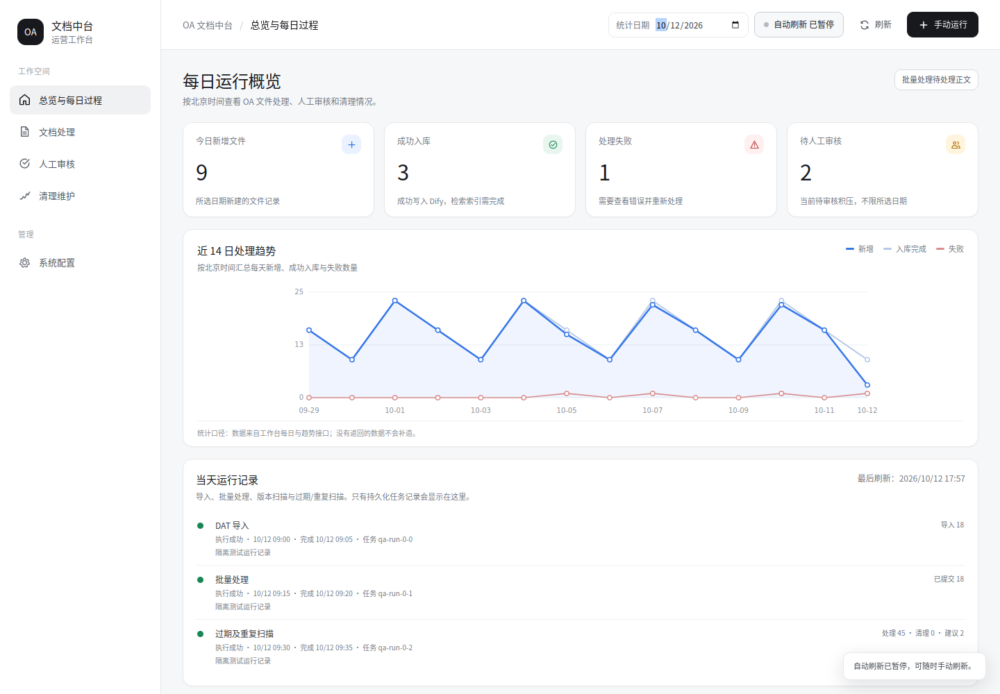

# OA 文档中台前端需求文档

版本：1.0；日期：2026-10-12；基于 NAS 与清理升级后的现有项目。

## 1. 目标及用户

为行内运维、知识库管理员和业务审核人员提供无需登录的中文工作台。进入页面即可理解 OA 文件从导入、读取、解析、模型分析、人工审核到 Dify 入库及历史清理的过程。页面使用真实数据库与任务状态，禁止以示例数字或固定“运行正常”冒充实际状态。

应用继续在行内现有 FastAPI / Celery / PostgreSQL / Redis 环境中部署。本次修改现有项目，不向外网部署。无需账户登录，不提供多语言和语言切换。审核人是操作时填写的审计信息，不构成登录认证。

## 2. 用户故事与验收标准

| 编号 | 用户故事 | 验收标准 |
| --- | --- | --- |
| US-01 | 运维进入工作台，希望马上知道今天是否正常运行 | 默认选北京时间今天；显示今天新增文件、成功入库、失败、待审核及清理概览；加载、无数据、接口失败均有不同提示；最后刷新时间来自真实请求 |
| US-02 | 运维希望按日回顾导入和处理过程 | 可选择日期；显示导入、批量处理、版本扫描、过期/重复扫描等运行记录，含开始/结束、状态、结果数量和错误摘要；新任务持久化，不能只依赖 Redis 临时结果 |
| US-03 | 业务人员希望知道一份文件卡在哪里 | 文档表支持关键词、状态、分类及分页；详情呈现读取、解密/直读、解析、分析、审核和入库阶段、各阶段日志、错误说明、模型摘要及附件下载 |
| US-04 | 管理员希望失败后继续处理 | 单个待处理或失败正文可以重新提交；运行中的文件不重复提交；操作显示任务编号和排队状态；队列不可用明确报错，不假装成功 |
| US-05 | 审核人员希望清楚知道是否应该入库 | 待审核页展示原文/摘要、模型置信度、理由和目标知识库；支持批准或拒绝并填写意见；审批提交后刷新状态 |
| US-06 | 管理员希望理解历史文档为什么被清理 | 展示清理类型、原文依据、失效日期、保留文件、审核状态、错误及执行审计；预览只生成建议；审核与执行分开，执行前展示具体对象及确认提示 |
| US-07 | 运维希望无需修改代码就配置系统 | 配置页提供 NAS 路径映射、DAT 导入、解析服务、模型网关、Dify、清理规则、筛选规则及必要基础连接参数；每项有中文名称、帮助、类型和校验；保存后持久化 |
| US-08 | 运维希望知道配置什么时候生效 | 界面标明即时生效和重启生效；热配置在 API 后续请求和 Worker 后续任务读取，运行中的任务不切换配置；数据库/Redis 等基础参数保存后提示重启 API、Worker、Beat |
| US-09 | 运维希望配置密钥而不暴露已有密钥 | 密钥只显示“已配置/未配置”；输入留空保留原密钥，清除必须显式操作；GET 不返回已有密码/API Key，错误和保存结果不包含密钥 |
| US-10 | 使用旧办公电脑的用户希望正常访问 | 支持 Chrome 109；本地静态资源，无 CDN 依赖；使用普通 CSS、十六进制颜色、ES2019/Chrome109已有API；不使用 oklch、CSS nesting、:has、container queries、view transitions、Popover API 或现代框架运行时 |
| US-11 | 管理员希望了解系统健康而不误判 | 提供真实 API/任务/存储连接状态；无法确认时显示未知或连接失败；挂载目录存在不等同于 NAS 实际在线，界面说明检测范围 |

## 3. 页面与交互

### 总览 / 每日过程

左侧固定导航，顶部页面名、日期、刷新及“手动运行”主按钮。四张指标卡：新增文件、入库完成、处理失败、待人工审核。近 14 日处理趋势使用本地 SVG，标注统计口径。当天任务时间线/列表展示导入、批量处理和清理任务。处理阶段总览和需要处理的异常位于下方。启用 15 秒刷新，可暂停；切换页面保留用户所选日期。

### 文档处理

表格列：文件名/分类、当前阶段、状态、最后处理时间及操作。可查看、下载及重新处理。打开详情抽屉后显示完整状态流程、处理日志、模型判断、正文和附件；日志和正文安全地作为文本呈现，不能执行其中的 HTML。

### 人工审核

展示待入库审核的正文，支持查看详情、批准、拒绝和意见；批准后由现有异步任务重新读取/解析并入库。

### 清理维护

提供“扫描过期与重复”“扫描制度版本”和清理建议表。扫描默认预览。依据、保留文档、目标数据集以及批准/拒绝/执行/重试可见。执行删除需在页面确认具体文件，保留服务端复核和审计，不能仅靠前端按钮禁用。

### 系统配置

分组表单：NAS 与导入、解析与模型、Dify 与分类映射、清理与筛选、基础连接。所有标签和帮助文字中文。显示配置版本；并发保存冲突返回明确提示，不覆盖他人刚保存的版本。修改表单后自动刷新不得覆盖用户输入。保存提示即时项和重启项。

支持知识库配置与业务分类映射：知识库名称、数据集、接口地址、API Key、状态；分类映射目标知识库、最低置信度、自动审核阈值、提示词及启用状态。编辑按数据库持久化并清空对应模型/知识库缓存。

## 4. 视觉规范

参考图：白色侧栏、黑色主操作、浅灰背景和卡片、细灰边框、圆角 12–16px、少量蓝色趋势图；避免重阴影和大面积彩色装饰。桌面侧栏约 224px；字号 14px 主体、12px 辅助、24px 页面标题、32px 指标。字体使用系统中文字体：PingFang SC / Microsoft YaHei / Noto Sans CJK SC / sans-serif，不联网下载字体。

图标用本地 SVG，按钮同时有中文文案。状态有文字，不只靠颜色。100% 和 125% 缩放可用；1366×768 办公屏幕主体不横向溢出，表格在自身容器中滚动。窄屏侧栏可折叠，键盘能操作按钮、抽屉和确认框；焦点可见。

## 5. 接口契约（基址 /api/v1）

### 每日与文档

- `GET /console/daily?date=YYYY-MM-DD` → `{date,timezone:"Asia/Shanghai",summary:{imported,processed,completed,failed,skipped,awaiting_approval,cleanup_candidates,deleted},pipeline:[{key,label,count}],runs:[{id,task_id,kind,label,status,started_at,finished_at,counts,error,message}],activity:[...]}`。today 默认按北京时间，所有时间戳输出 ISO8601 及明确时区。缺少历史任务记录显示说明，不凭旧日志编造运行记录。
- `GET /console/trend?days=14` → `{timezone,items:[{date,imported,completed,failed,deleted}]}`。
- `GET /console/documents?date=&page=1&page_size=20&status=&category=&q=` → `{total,page,page_size,items:[{file_id,filename,category,category_label,status,status_label,progress,current_step,message,last_error,started_at,completed_at,document_id,dataset_id,filesize,filerealpath,is_zw}]}`；date 可省略查全部。日期筛选表示当日同步/处理/日志涉及文件，页面必须说明口径。
- `POST /console/actions` → 请求 `{action:"import"|"process_pending"|"scan_cleanup"|"scan_versions",limit:20,dat_file_path:null,update_existing:false,dry_run:true}`；返回 `{success,task_id,message}`。前端扫描始终明确预览模式。后台任务记录通过 Celery 发布/执行信号自动追踪，覆盖定时及手动任务。
- 文件详情、日志、处理、审批和附件沿用既有 `/files/{id}`、`/logs/{id}`、`/files/{id}/process`、`/files/{id}/approve`、`/files/{id}/attachments`、`/oafile/download/{id}`。
- 清理建议、审核、执行沿用已有 `/maintenance/cleanup-candidates`、`/{id}/review`、`/{id}/execute`。

### 配置

- `GET /console/config` → `{version,values:{key:value},fields:[{key,label,type,group,secret,apply:"hot"|"restart",help,options:[{value,label}],min,max}],secrets:{key:boolean},restart_required:[key],updated_at}`；secret 的 value 不返回已有值。
- `PATCH /console/config` → `{version,values:{仅提交修改项},clear_secrets:[key],operator:"页面操作"}`；返回 `{success,version,message,hot_applied:[key],restart_required:[key]}`。未知键/非法类型返回422，版本冲突409，持久化失败不能声称已保存。配置文件以原子替换写入共享目录，权限0600；敏感值不写到普通审计日志。启动时载入配置覆盖 `.env` 默认值；数据库及Redis变更不得在当前进程自动换连接。
- `GET/POST /console/knowledge-bases`；`PATCH /console/knowledge-bases/{id}`；`GET/PUT /console/category-mappings`（PUT `{items:[{business_category,knowledge_base_id,min_confidence_score,auto_approve_threshold,ai_prompt_template,is_active}]}`）。所有GET密钥脱敏；知识库返回 `id,name,description,dify_dataset_id,base_url,status,api_key_configured`。知识库已有入库文档时禁止随意变更其数据集身份。

## 6. 技术分工与集成约束

- 前端子任务：只编辑 `web/`，实现纯本地HTML/CSS/JS；不改后端或部署；使用上述契约。
- 每日过程子任务：`api/console.py`、`services/operations.py`、`models_operations.py`、`tasks/document_processor.py` 及自己的测试；负责持久任务记录、日汇总、文档查询和动作提交，保留现有任务处理逻辑。
- 配置子任务：`api/console_config.py`、`services/runtime_config.py`、`config.py` 及自己的测试；实现持久配置、热刷新、知识库配置及映射；不编辑 main、database、tasks、部署文件或其他任务拥有的代码。
- 主任务：整合 main、数据库模型注册、共享配置卷、启动入口、文档、完整测试和浏览器兼容检查。
- 子任务使用 GPT-6 Luna、最高可选思考强度 max。任务间避免同文件并发编辑。

## 7. 验证与交付

保留现有39项离线回归；新增日边界、真实任务记录、分页/过滤、失败显示、配置脱敏/类型校验/原子保存/并发冲突/热刷新和重启边界测试。执行页面交互测试：日期、导航、详情、入库审核、清理预览与审核、保存配置和密钥留空保留。以Chrome109支持的语法和功能实现；尽量执行Chromium109真实浏览检查，若运行环境不能提供该浏览器，必须说明验证范围，不以当前Chrome测试结果冒称109实测。

交付完整项目包、代码补丁、本文需求文档、部署说明和可检查的界面预览。无需登录不代表浏览器中保存数据库密码：所有已有秘密仅由服务端保存，页面不回显。

### 最终验收记录（2026-10-12）

三项实现由 GPT-6 Luna 子智能体以 max 思考强度并发完成，主任务完成接口集成和验证。69 项离线回归全部通过；使用真实 Chromium 109.0.5414.46 完成 18 项交互检查，全部通过且无页面脚本异常。

浏览器检查覆盖每日统计和时区、自动刷新暂停、历史日期、全部历史查询和分页、筛选与正文/XSS保护、中文下载、失败重提、入库审批、清理审批与执行分离、扫描预览、热配置保存与密钥脱敏、密钥留空保留、未保存草稿保护、并发冲突、知识库新增与地址继承、分类阈值保存，以及1366办公屏/125%等效视窗/窄屏布局。

数据来自隔离 SQLite 和模拟外部服务；验收不代表已经连接行内 NAS、DeepSeek、Dify 或验证 PostgreSQL 并发与真实 Docker 部署。代码未推送 GitHub，未修改生产环境。部署和进一步联调见 [中文工作台部署说明](CONSOLE_DEPLOYMENT.md)。

工作台截图（隔离测试数据）：

